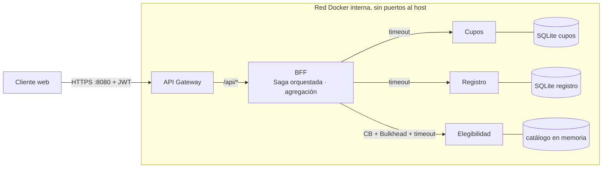
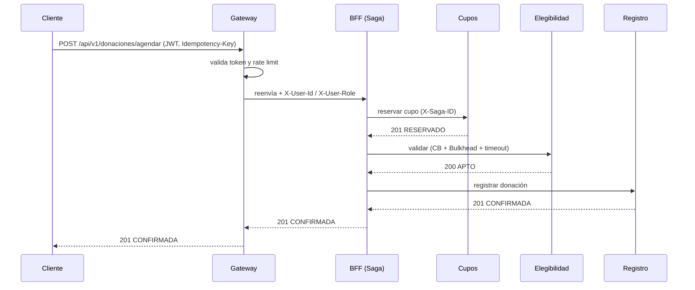
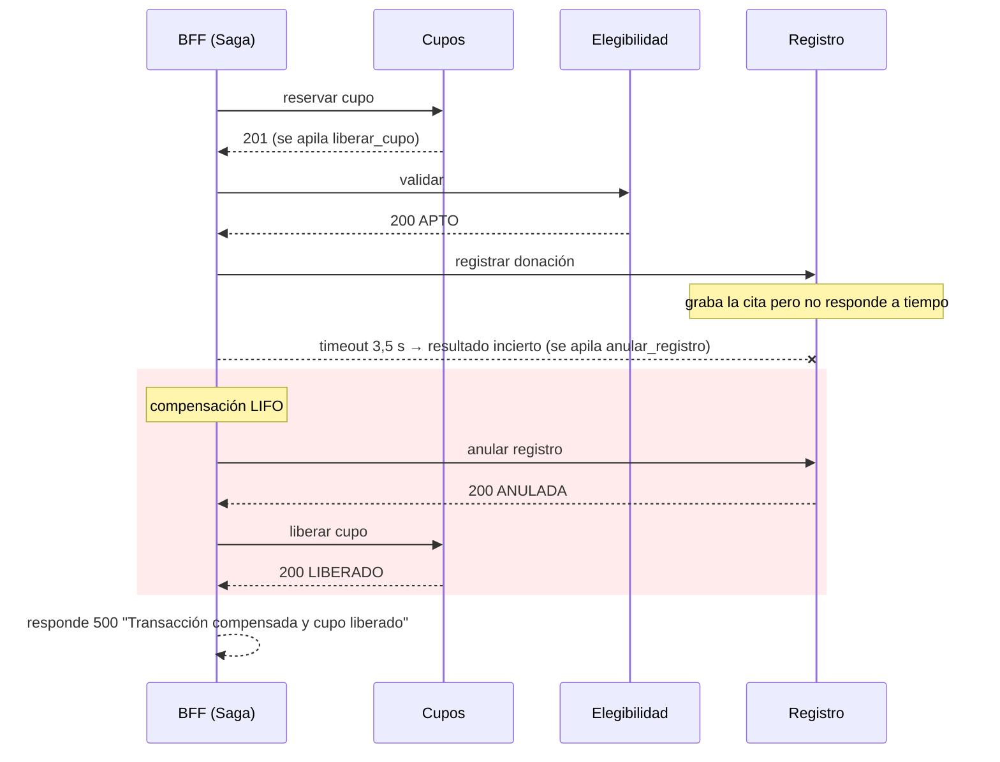
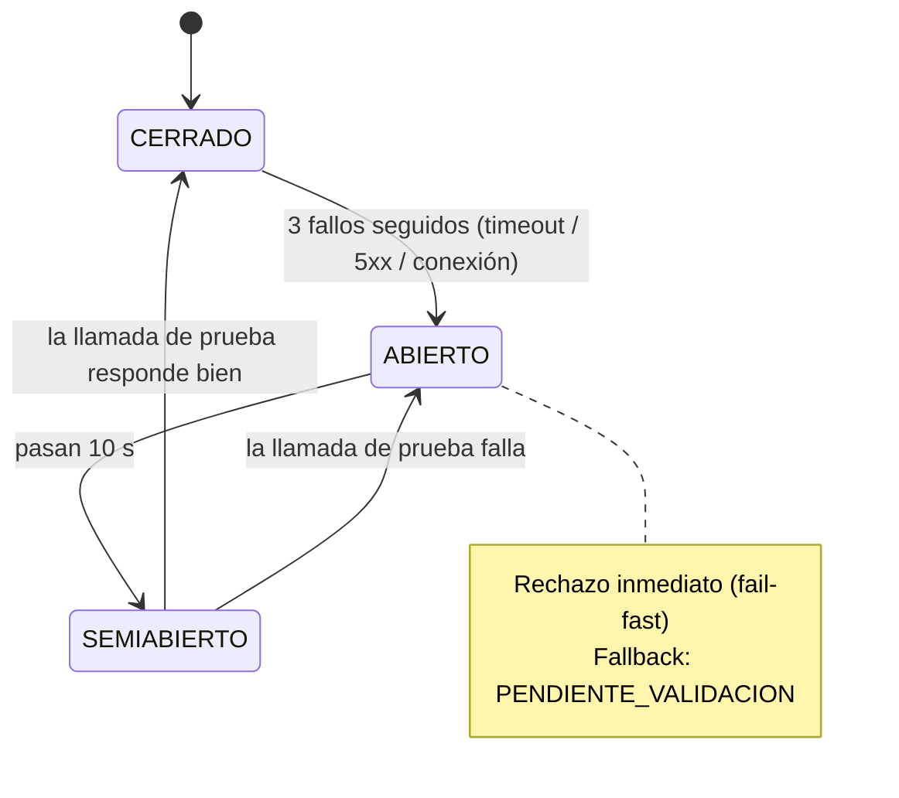
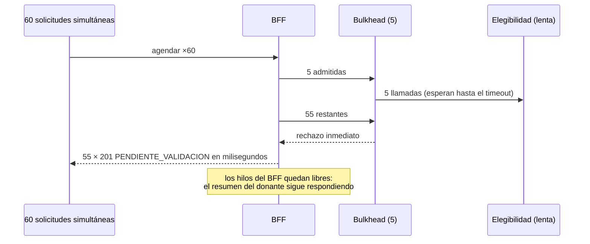

# Informe — Sistema distribuido resiliente para agendar donaciones de sangre (Forma N)

Integración de Sistemas · Unidad 3 · Equipo: Jesús Guevara, Francisco Cifuentes, Rodrigo Bascuñán

## 1. Problema y alcance

Un banco de sangre agenda donaciones coordinando tres servicios: **Cupos** (reserva un cupo de la jornada), **Elegibilidad** (servicio externo, lento e inestable, que valida si el donante es apto) y **Registro** (registra la donación). La operación «agendar una donación» cruza los tres y se implementa como **Saga**. El sistema se expone con un **API Gateway** y un **BFF**, y se protege con **timeouts, Circuit Breaker y Bulkhead** sobre Elegibilidad.

Reglas de negocio: no se agenda por sobre el cupo de la jornada, no se registra a un donante no apto y, si Elegibilidad no responde, la cita queda **pendiente de validación** en vez de colgarse.

## 2. Arquitectura

- Todo se levanta con un solo `docker compose up`. Solo el gateway publica un puerto (8080); el resto vive en una red `internal: true`, sin salida al host.
- **Base de datos por servicio:** Cupos y Registro tienen su propio SQLite en volúmenes separados, con modo WAL y transacciones `BEGIN IMMEDIATE` para que la reserva sea atómica bajo concurrencia. Ningún servicio lee la base de otro.
- **Elegibilidad** simula un servicio externo de solo lectura: su "almacén" es un catálogo de historial clínico en memoria. No se le agregó persistencia porque en el dominio real no la administramos nosotros; lo que importa es su comportamiento frágil, que se controla con endpoints de caos (`/config/latencia`, `/config/falla`).

### 2.1 Separación de responsabilidades

| Componente | Hace | No hace |
|---|---|---|
| **API Gateway** | Valida el JWT (HS256, roles `lectura`/`escritura`), rechaza escrituras del rol lectura (403), limita peticiones por usuario (`sub` del token; 15/min) y enruta `/api/*` al BFF inyectando `X-User-Id` y `X-User-Role` | Ninguna regla de negocio: no conoce cupos, citas ni donantes |
| **BFF (cliente web)** | Orquesta la Saga, aplica CB y Bulkhead a Elegibilidad y compone el **resumen del donante** con datos de Registro y Cupos en una sola respuesta (con `datos_parciales` y `advertencias` si uno falla; 503 si fallan ambos) | Persistir datos de dominio |
| **Servicios de dominio** | Su operación local, idempotente por `id_saga`, y su compensación | Llamar a otros servicios |

## 3. Decisiones de diseño

### 3.1 Saga y no Two-Phase Commit

Two-Phase Commit exige que todos los participantes voten en una fase de preparación y mantengan sus recursos bloqueados hasta que el coordinador decida. En este dominio eso no es viable:

1. **Elegibilidad es externo.** No controlamos su implementación, no expone una fase `prepare` ni soporta transacciones XA. No puede participar en un protocolo de commit atómico.
2. **Es lento e inestable.** Con 2PC, el cupo reservado en Cupos quedaría bloqueado mientras Elegibilidad tarda o no responde; una dependencia lenta bloquearía las reservas de toda la jornada. Es exactamente la falla en cascada que queremos evitar.
3. **El coordinador es un punto de bloqueo.** Si el coordinador cae entre fases, los participantes quedan en duda con recursos retenidos.
4. **El negocio tolera consistencia eventual.** Una cita puede quedar `PENDIENTE_VALIDACION` y confirmarse después; no se necesita atomicidad estricta e instantánea.

La Saga ejecuta transacciones **locales** en cada servicio y, si un paso falla, deshace los anteriores con **compensaciones**. A cambio se acepta que existan estados intermedios visibles por un instante y se exige que pasos y compensaciones sean idempotentes.

### 3.2 Orquestación y no coreografía

Elegimos una Saga **orquestada** por el BFF:

- **El flujo es lineal y corto** (reservar → validar → registrar). Un orquestador lo expresa en un solo lugar (`bff/src/saga.py`) y la pila de compensaciones queda explícita.
- **Las decisiones dependen del resultado de Elegibilidad** (apto, no apto o sin respuesta). Con coreografía, cada servicio tendría que reaccionar a eventos de los otros y esa lógica quedaría repartida.
- **La resiliencia se concentra donde está la dependencia frágil.** El orquestador es quien llama a Elegibilidad, así que ahí viven el timeout, el Circuit Breaker, el Bulkhead y el fallback.
- **Trazabilidad:** todo el log de una Saga lleva el mismo `id_saga`; con coreografía habría que reconstruir el flujo desde eventos de varios servicios.
- **No requiere un broker de mensajes**, lo que simplifica el despliegue con un único `docker compose up`.

El costo es que el BFF es un punto central: si cae a mitad de una Saga, ésta queda sin terminar. Se mitiga con la idempotencia (el cliente puede reintentar con la misma clave) y con compensaciones que se pueden repetir sin daño.

### 3.3 Pasos, compensaciones y orden inverso

| Paso | Servicio | Compensación |
|---|---|---|
| 1. Reservar cupo | Cupos `POST /cupos/reservar` | Liberar cupo `POST /cupos/liberar` |
| 2. Validar elegibilidad | Elegibilidad `POST /elegibilidad/validar` | Ninguna (solo valida) |
| 3. Registrar donación | Registro `POST /registro/donaciones` | Anular `POST /registro/donaciones/{id_saga}/anular` |

El orquestador apila cada compensación al confirmar su paso y, ante un error, las ejecuta en **orden inverso** (LIFO). Detalles relevantes:

- **Resultado cierto o incierto en el paso 3.** Si Registro responde un error (por ejemplo 500), se sabe que no grabó y basta con liberar el cupo. Si no responde a tiempo (timeout), pudo haber grabado: se apila también `anular_registro`, y la compensación es `anular_registro → liberar_cupo`.
- **Si una compensación falla, la cadena se detiene** y la respuesta lo informa ("requiere reconciliación"). Así no se libera un cupo mientras su cita sigue activa.
- **Reintentos con backoff** (3 intentos, 0,3 s × intento) en cada compensación.
- **No apto:** Elegibilidad responde 422, la Saga libera el cupo y responde 422 al cliente.
- **Elegibilidad no responde:** no es un error de la Saga. Se **degrada**: la cita se registra como `PENDIENTE_VALIDACION`.

### 3.4 Idempotencia

- El cliente envía `Idempotency-Key`. El BFF la convierte en un `id_saga` determinista (UUIDv5), así que un reintento con la misma clave es la misma Saga.
- Cupos y Registro tienen `id_saga UNIQUE`. Un reintento con los mismos datos devuelve el resultado ya guardado (`200`, `idempotente: true`) sin descontar stock de nuevo; el mismo `id_saga` con datos distintos es una colisión (`409`) y la Saga compensa.
- Las compensaciones también son idempotentes: liberar o anular dos veces deja el mismo estado.
- **Reintento tras una Saga degradada:** si el primer intento quedó `PENDIENTE_VALIDACION` y en el reintento el donante resulta no apto, la Saga anula la cita previa además de liberar el cupo, para no dejar una cita sin cupo.
- Todo cambio queda en las bitácoras `log_cupos` y `log_registro`.

### 3.5 Resiliencia

| Mecanismo | Configuración | Comportamiento |
|---|---|---|
| **Timeouts** | 3,5 s por paso de la Saga; 4 s en las consultas del resumen; 40 s del gateway al BFF | Ninguna llamada entre servicios espera indefinidamente |
| **Circuit Breaker** (Elegibilidad) | Abre tras 3 fallos seguidos; prueba de nuevo a los 10 s | Cuenta como fallo: timeout, error de conexión y 5xx. **No** cuenta los 4xx (un "no apto" es una respuesta válida) ni los rechazos del Bulkhead. Estados `CERRADO → ABIERTO → SEMIABIERTO`; en semiabierto deja pasar una sola llamada de prueba |
| **Bulkhead** (Elegibilidad) | Semáforo de 5 llamadas simultáneas, sin espera | La llamada número 6 se rechaza al instante en vez de ocupar un hilo esperando |
| **Fallback** | `PENDIENTE_VALIDACION` | Con el circuito abierto o el Bulkhead lleno, la Saga no llama a Elegibilidad y registra la cita como pendiente |

El Circuit Breaker envuelve al Bulkhead: si el circuito está abierto, la llamada ni siquiera consume un lugar del Bulkhead. El recurso que protege el Bulkhead es el **pool de hilos del BFF** (40 hilos): sin límite, una Elegibilidad lenta retiene un hilo por solicitud y deja sin capacidad al resto de las funciones del BFF.

## 4. Diagramas

### 4.1 Flujo feliz

### 4.2 Falla del último paso: compensación en orden inverso

Si Registro responde un 500 (no grabó), la pila solo tiene `liberar_cupo`. Si el donante no es apto (422 en el paso 2), también se compensa solo el cupo.

### 4.3 Falla en cascada contenida

## 5. Experimentos

### 5.1 Diseño

Los experimentos se ejecutan con `python experimentos/demo.py <escenario>` (ver el README). Para que sean claros y reproducibles:

- Cada escenario **levanta el sistema con su configuración** (por ejemplo `CB_ACTIVO=false` en la versión sin patrón) y reinicia el BFF para partir con contadores en cero.
- Las fallas se **inducen** con los endpoints de caos; nada se simula en el cliente.
- Todas las solicitudes pasan **por el gateway con JWT**, como un cliente real.
- Cada corrida usa una **jornada propia**, así los resultados no dependen de datos anteriores.
- Las versiones con y sin patrón siguen **el mismo protocolo**: mismas fases, mismas pausas y misma cantidad de solicitudes.
- Al final se **verifica la consistencia**: cada cupo reservado en Cupos debe tener su cita activa en Registro y viceversa.
- Se guarda la evidencia: salida completa, CSV por solicitud, estado de `/resiliencia/estado` antes y después, y los eventos JSON del BFF (`circuito_transicion`, `bulkhead_rechazo`). La corrida de referencia está en `experimentos/evidencia/`.

### 5.2 Resultados e interpretación

**Escenario 1 — Éxito.** 5 de 5 solicitudes quedan `CONFIRMADA` (≈0,04 s cada una), con los tres pasos firmes. Un reintento con la misma `Idempotency-Key` devuelve la **misma cita** y Registro lo marca `idempotente=True`; el stock no se descuenta dos veces.

**Escenario 2 — Fallo del último paso con compensación.**

| Caso | Compensaciones ejecutadas (log del BFF) | Estado final |
|---|---|---|
| Registro graba pero responde tarde (incierto) | `anular_registro → liberar_cupo` | cita `ANULADA`, cupo `LIBERADO` |
| Registro cae con 500 (no graba) | `liberar_cupo` | sin cita, cupo `LIBERADO` |
| Donante no apto (422 en el paso 2) | `liberar_cupo` | sin cita, cupo `LIBERADO` |

En los tres casos el stock vuelve a su valor inicial y no quedan reservas sin cita ni citas sin cupo. Sin compensaciones, cada caso dejaría un cupo descontado para una donación que no existe.

**Escenario 3 — Elegibilidad lenta y luego caída (Circuit Breaker).** 10 solicitudes: 5 con Elegibilidad lenta (5 s, mayor que el timeout) y 5 con Elegibilidad caída (HTTP 500), con las mismas pausas en ambas corridas.

| Fase | Con Circuit Breaker | Sin Circuit Breaker |
|---|---|---|
| Lenta (5 solicitudes) | **10,7 s**; 3 llegan a Elegibilidad | **17,9 s**; 5 llegan |
| Caída (5 solicitudes) | 0,2 s; **1** llega (la llamada de prueba) | 0,3 s; **5** llegan |
| Transiciones registradas | `CERRADO→ABIERTO→SEMIABIERTO→ABIERTO→SEMIABIERTO→CERRADO` | — |

Interpretación: con el servicio **lento**, las 3 primeras solicitudes esperan el timeout (≈3,5 s) y el circuito se abre; desde la cuarta, la respuesta es inmediata (≈0,03 s) con el fallback. Sin el patrón, **cada** solicitud paga los 3,5 s. Con el servicio **caído**, un 500 llega rápido en ambos casos, así que la ganancia no es de tiempo sino de **carga sobre la dependencia**: con el circuito abierto solo pasa la llamada de prueba (que falla y lo reabre), mientras que sin el patrón las 5 solicitudes siguen golpeando a un servicio caído, lo que en un caso real le impediría recuperarse. Al repararlo, la siguiente llamada de prueba cierra el circuito y vuelve `CONFIRMADA`.

**Escenario 3b — Bulkhead.** 60 solicitudes simultáneas con Elegibilidad lenta; el Circuit Breaker se apaga en ambas corridas para aislar el efecto del Bulkhead. Durante la carga se lanzan 5 consultas simultáneas al resumen del donante, una función que no depende de Elegibilidad.

| Métrica | Con Bulkhead | Sin Bulkhead |
|---|---|---|
| Llamadas simultáneas a Elegibilidad (máximo observado) | **5** (55 rechazadas al instante) | **40** |
| Agendamiento, mediana (p50) | **0,42 s** | **3,82 s** |
| Resumen del donante durante la carga (5 consultas) | **0,04 s** cada una | **3,3 s** cada una |

Interpretación: sin Bulkhead, las solicitudes ocupan los **40 hilos** del BFF esperando a Elegibilidad (el máximo observado es justamente el tamaño del pool), las 20 restantes hacen fila y una función ajena a Elegibilidad, el resumen, queda bloqueada más de 3 s: la lentitud de una dependencia se propaga al resto del sistema. Con Bulkhead, solo 5 hilos esperan, los otros 55 se rechazan al instante con el fallback y el resto del BFF sigue respondiendo en 40 ms. Todas las solicitudes terminan en `201` y Cupos y Registro quedan consistentes en ambas corridas.

**Rate limiting.** Una ráfaga de 20 consultas de un mismo usuario contra el límite por defecto (15 por minuto) recibe **429** con `Retry-After` desde la solicitud 16. El límite se cuenta por usuario autenticado, así que un cliente no agota la cuota de otro.

## 6. Limitaciones conocidas

- **Compensación que llega antes de grabar.** Si un paso da timeout y la compensación llega antes de que el servicio termine de grabar, el servicio responde 404 y no deja marca de que la operación fue cancelada. La Saga ya no acepta ese 404 como éxito tras un timeout (lo informa para reconciliación), pero la solución completa es que Cupos y Registro registren el `id_saga` cancelado y rechacen la operación tardía (issue #14).
- **Estado en memoria por instancia.** El Circuit Breaker, el Bulkhead y el rate limit viven en la memoria de una sola instancia del BFF y del gateway. Con varias réplicas habría que compartirlos (por ejemplo en Redis).
- **Elegibilidad sin persistencia,** por ser un servicio externo simulado (sección 2).
